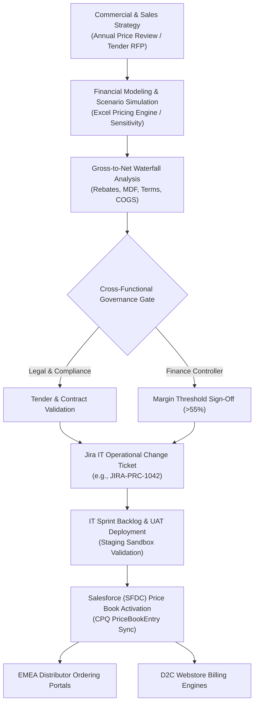

# EMEA Commercial Pricing & Margin Analytics Engine

[](https://github.com/debbrataadhikary/emea-commercial-pricing-model)
[](https://github.com/debbrataadhikary/emea-commercial-pricing-model)
[](https://github.com/debbrataadhikary/emea-commercial-pricing-model)
[](https://opensource.org/licenses/MIT)

An enterprise-grade commercial financial model, automated pricing pipeline, and operational governance framework engineered for **Dexcom EMEA Commercial Distribution and Direct-to-Consumer (D2C) channels**.

This repository bridges executive commercial strategy, finance/legal governance, and IT sprint execution by simulating **Gross-to-Net margin waterfalls**, auditing **EU cross-border price corridors**, modeling **econometric price elasticity**, and automating **Salesforce (SFDC) Price Book updates via Jira release workflows**.

---

## 1. Executive Summary & Strategic Rationale

In high-growth medical device and continuous glucose monitoring (CGM) commercial operations, pricing decisions require an intricate balance between:
1. **Multi-Channel Distribution:** Managing Authorized Distributor tiers (Tier 1 vs Tier 2), Hospital/Public Tenders, and Direct-to-Consumer (D2C) webstores.
2. **Cross-Border Parity & Parallel Import Prevention:** Preventing arbitrage within the EU Single Market where price variances exceeding 15% trigger parallel trade between member states.
3. **Gross-to-Net Realization:** Moving beyond gross list prices to model true net realized average selling prices (ASP) factoring in volume rebates, market development funds (MDF), cash discounts, and logistics.
4. **Agile IT Execution:** Translating commercial price changes into audit-compliant Jira requests and automated Salesforce CPQ PriceBookEntry uploads.

---

## 2. End-to-End Operational Architecture



---

## 3. Financial Modeling & Methodology

### 3.1 Gross-to-Net Margin Waterfall
The engine models the complete revenue deduction bridge to calculate true contribution margin:

$$\text{Net Realized ASP} = \text{Gross List Price} - \text{Base Contractual Discount} - \text{Volume Rebate} - \text{Co-Op MDF} - \text{Cash Terms (2/10 Net 30)} - \text{Cross-Border Freight}$$

$$\text{Contribution Margin \%} = \frac{\text{Net Realized ASP} - \text{Direct Unit COGS}}{\text{Net Realized ASP}}$$

* **Optimal Threshold:** Contribution margin $\ge 60\%$
* **Review Threshold:** $50\% \le \text{Margin} < 60\%$
* **Critical Flag:** Margin $< 50\%$ (triggers automated commercial freeze)

### 3.2 Econometric Price Elasticity of Demand (PED)
Demand response to pricing updates is modeled via log-log ordinary least squares (OLS) regression:

$$\ln(Q_t) = \beta_0 + \beta_1 \ln(P_t) + \varepsilon_t$$

Where:
* $\beta_1$ represents the **Price Elasticity Coefficient** (empirically estimated at **-1.38** to **-1.65** across key EU markets like Germany and the UK).
* Used in dynamic sensitivity tables to forecast unit volume changes and prevent unintended margin erosion during price indexations.

---

## 4. Repository Structure & Artifacts

```text
emea-commercial-pricing-model/
├── emea_commercial_pricing_engine.xlsx    # Production Excel financial model (5 comprehensive tabs)
├── pricing_engine.py                     # Python econometric elasticity & SFDC export pipeline
├── data/
│   └── historical_weekly_demand.csv      # Synthetic 52-week historical pricing & volume series
├── exports/
│   ├── sfdc_price_book_entries_upload.csv# Formatted CSV for Salesforce Data Loader
│   ├── emea_price_corridor_audit.csv     # EU cross-border price parity & parallel risk audit
│   └── qa_pricing_audit_log.csv          # Automated QA verification & compliance checklist
├── requirements.txt                      # Python dependencies (openpyxl, pandas, numpy)
├── LICENSE                               # MIT License
└── README.md                             # Architectural documentation & executive briefing
```

---

## 5. Excel Model Structure (`emea_commercial_pricing_engine.xlsx`)

The financial workbook contains **6 interconnected, formula-driven worksheets** with **242 active Excel formulas** (0 hardcoded shortcuts, 0 errors):

1. **`Control_and_Parameters` (Global Master Assumptions):**
   * **Active Scenario Switcher (Cell `B5`):** Dynamically toggles between 4 strategic scenarios using `=INDEX(E5:E8, B5)`.
   * **Treasury FX Reference Table:** Budget rates vs spot rates for EUR, GBP, SEK, and DKK with variance formulas.
   * **Product Standard Cost & COGS Master:** Manufacturing unit costs and logistics benchmarks.
   * **Commercial Discount Policy Matrix:** Standard tiered discounts, annual volume rebates, co-op MDF, and cash terms (2/10 Net 30).
2. **`Executive_Summary` (C-Suite Decision Dashboard):**
   * **Dynamic KPI Scorecard:** Average Net Realized ASP (`=AVERAGE(...)`), Gross-to-Net Realization Rate (`=Net_ASP / Gross_List`), Blended Contribution Margin %, and Salesforce CPQ Deployment Parity.
   * **Formula-Driven Macro Decision Matrix:** Dynamic unit projections, revenue, gross profit, and margin percentage across all 4 scenarios linked directly to the assumptions tab.
3. **`Price_Book_Master` (Salesforce CPQ Ready):**
   * Aligned directly with Salesforce CPQ schema (`Pricebook2Id`, `ProductCode`, `Market`, `Currency`, `List Price`, `Contracted Price`).
   * **Dynamic Multi-Currency FX Conversion:** `=INDEX(FX_Rates, MATCH(Currency, Currency_List, 0))`.
   * **Policy Discount Automation:** `=INDEX(Discounts, MATCH(Channel, Channel_List, 0))`.
   * **EU Price Corridor Parity Audit:** Automated anomaly formula flagging cross-border price arbitrage risk:  
     `=IF(ABS(Price - AVERAGEIFS(...)) / AVERAGEIFS(...) > 0.15, "ARBITRAGE RISK", "COMPLIANT")`.
4. **`Gross_to_Net_Waterfall` (Dynamic Margin Bridge):**
   * Granular SKU and account-level waterfall bridge across Germany (MedSupply GmbH), UK (MediCare Alliance), France (Public Tender), Sweden (NordicHealth AB), and Baltics (BalticPharma UAB).
   * Dynamic deduction lookup for Base Discounts, Volume Rebates, Co-Op MDF, Payment Terms, and Freight.
   * Automated Health Status flags (`OPTIMAL (>60%)`, `ACCEPTABLE (50-60%)`, `MARGIN REVIEW (<50%)`).
5. **`Sensitivity_and_Elasticity` (Econometric Matrix):**
   * Two-Way Data Table calculating Total Gross Profit (€M) across price variations (-10% to +10%) and demand elasticities (-0.80 to -1.80).
   * Dynamic baseline lookup linked to Waterfall averages:  
     `=($B$5 * (1 + Delta_P * PED) * (($B$6 * (1 + Delta_P)) - $B$7)) / 1000000`.
6. **`Governance_and_Audit` (Jira & SFDC Deployment Integrity):**
   * Audit log linking commercial change requests (`JIRA-PRC-1042` through `1062`) to Legal/Compliance sign-offs, Finance approvals, and IT sprint releases.
   * Automated KPI formulas: `=COUNTA(...)`, `=COUNTIF(..., "Production Deployed")`, and deployment success rate.

---

## 6. How to Run the Python Automation Pipeline

### Prerequisites
* Python 3.9+
* Required packages: `pip install -r requirements.txt`

### Execution
Run the end-to-end pricing and econometric pipeline:
```bash
python pricing_engine.py
```

### Console Output
```text
[1/4] Running Econometric Price Elasticity Modeling...
  -> Estimated Price Elasticity (beta_1): -1.646
  -> Model R-Squared: 0.560
  -> Economic Interpretation: A 1.0% price increase reduces demand by 1.65%.
  -> Saved historical econometric dataset: data/historical_weekly_demand.csv

[2/4] Auditing Cross-Border EU Price Corridors & Parallel Import Risk...
  [OK]    Germany             : Net €42.85 (+1.0%) -> COMPLIANT
  [OK]    United Kingdom      : Net €43.15 (+1.7%) -> COMPLIANT
  [OK]    France (Tender)     : Net €41.58 (-2.0%) -> COMPLIANT
  [OK]    Sweden              : Net €44.75 (+5.5%) -> COMPLIANT
  [OK]    Baltics (LT/LV/EE)  : Net €41.98 (-1.0%) -> COMPLIANT
  [ALERT] Poland (Simulation) : Net €35.80 (-15.6%) -> CRITICAL PARALLEL RISK
  -> Exported Price Corridor Audit: exports/emea_price_corridor_audit.csv

[3/4] Exporting Salesforce (SFDC) PriceBookEntry Data Loader Format...
  -> Successfully generated 4 SFDC Price Book rows: exports/sfdc_price_book_entries_upload.csv

[4/4] Generating Automated QA System Sign-off...
  -> QA Audit Summary saved: exports/qa_pricing_audit_log.csv
```

---

## 7. Author & Professional Background

**Debbrata Kumar Adhikary**  
*Senior Pricing & Business Systems Analyst*  
Vilnius, Lithuania  
* Email: [adhikarydeb111@gmail.com](mailto:adhikarydeb111@gmail.com)  
* LinkedIn: [linkedin.com/in/debbrata-adhikary](https://linkedin.com/in/debbrata-adhikary)  
* GitHub: [github.com/debbrataadhikary](https://github.com/debbrataadhikary)  

**Academic Credentials:**
* **Master of Governance and Development Studies (MGDS)** | Jahangirnagar University, Dhaka (Institutional Policy & Systems Governance)
* **Master of Social Science (MSS) in Economics** | Dhaka College (National University) (Econometric Modeling & Statistics)
* **Bachelor of Social Science (BSS Honours) in Economics** | BL College, Khulna (National University) (Quantitative Methods & Price Theory)
* **Google Project Management Professional Certificate** | Coursera (Agile Delivery, Jira Sprints & Cross-Functional Alignment)
